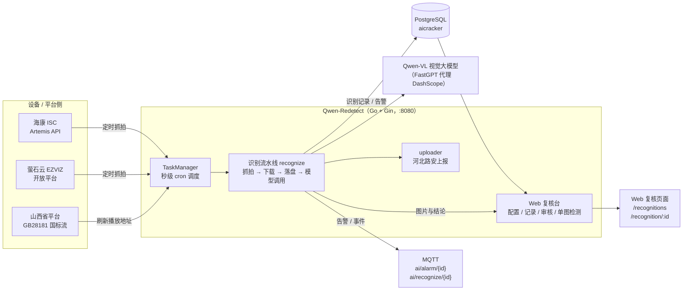

<div align="center">

# Qwen-Redetect

**Qwen-VL 驱动的摄像头视频 / 图像 AI 识别复核服务**

定时抓拍 → 视觉大模型识别 → 结果落库 → Web 人工复核 → 告警推送，一个 Go 服务打通全链路。

[](https://go.dev/)
[](https://help.aliyun.com/zh/model-studio/vision)
[](https://www.postgresql.org/)
[](https://www.docker.com/)
[](#许可证)

</div>

---

## 这是什么

Qwen-Redetect 是一个面向**道路 / 边坡 / 桥梁等基础设施监控**的 AI 识别复核服务。它按配置的周期，从海康 ISC（Artemis）、萤石云（EZVIZ）等平台抓取摄像头画面，把图片交给 **Qwen-VL 视觉大模型**判定是否存在滑坡、边坡坍塌、桥梁垮塌、火灾、洪水等灾害，再把识别结论、图片、审核状态写入 PostgreSQL，并通过内置的 **Web 复核台**做人工复核、告警确认与历史追溯。

与"只调用一次大模型就报警"的常见做法不同，本服务在告警前会追加一次**图像有效性复核**：只有"图像整体不可辨 **且** 看不到明确灾害证据"时才撤销告警，其余不确定情形一律保守保留告警并等待人工确认，以降低漏报。

> 本仓库是内部生产服务 `video-recognition` 的公开源码整理版：真实凭据已全部脱敏（见[安全与脱敏说明](#安全与脱敏说明)），运行期抓拍图片、日志与编译产物未入库。

---

## 核心特性

- **多平台设备接入**：海康 ISC Artemis（`x-ca-*` HMAC 签名）、萤石云开放平台（AppKey/Secret + access token 缓存）、山西省平台国标流（GB28181，SM2 国密加密登录并定时刷新播放地址）。
- **秒级定时调度**：基于 `robfig/cron` 的 `TaskManager`，按摄像头配置的 `interval_sec` 自动生成秒/分/时/天级 cron 表达式；Web 端增删改配置即时同步到调度器，无需重启。
- **双档视觉模型**：日常抓拍用轻量模型（`lite_model`），每 `big_check_interval_min` 分钟（默认 60）自动升级为大模型（`big_model`）复核一次，兼顾成本与精度。
- **图像有效性二次复核**：主模型告警后，再用独立提示词判断 `image_invalid` / `disaster_visible`，避免大雾、过曝、低照度、遮挡导致的误报，同时避免误撤销真实灾害。
- **多通道结果输出**：MQTT 告警（`ai/alarm/{camera_id}`）与识别事件（`ai/recognize/{camera_id}`）、七牛对象存储、河北路安平台图片上报、邮件 / 企业微信通知。
- **内置 Web 复核台**：摄像头任务 CRUD、识别记录筛选与 CSV 导出、告警/正常状态审核（审核通过自动补发告警）、单图即时检测、设备历史记录。
- **本地图片闭环**：抓拍图片按 `images/YYYY-MM-DD/` 落盘，`/images` 静态路由与同源 `/recognition/:id/image` 下载接口复用本地文件，过期目录自动清理（默认保留 60 天）。
- **外部检测触发**：`POST /api/alarm` 接收本地轻量模型的检测结果（含图片 Base64 与 `sure` 标志），`sure=true` 时跳过 LLM 直接走告警 / 上报链路。
- **一键部署**：Dockerfile（`CGO_ENABLED=0` 静态编译）+ Kubernetes `deploy.yaml`（`conf.ini` 由 ConfigMap 挂载）。

---

## 架构总览



---

## 识别流水线

1. **调度**：`TaskManager` 按 `CameraLLM.IntervalSec` 生成 cron 表达式（`LLM_MONITOR=true` 时才会注册任务）。
2. **抓拍**：`hikisc` 走海康 ISC 手动抓拍接口，`yingshi` 走萤石云抓图接口；抓拍失败会记录错误并结束本轮。
3. **落盘**：图片下载后保存到 `[recognize] image_dir`（默认 `images/日期/`），记录同源 URL 与本地路径。
4. **主模型识别**：把图片转为 Base64 data URL 调用视觉模型，解析返回 JSON 的 `warning` 与 `describe`；`#test` 提示词会跳过真实调用，便于联调告警链路。
5. **有效性复核**：`warning=true` 时追加第二遍调用（`AbnormalPrompt`），判定 `image_invalid` 与 `disaster_visible`；仅在"图像完全不可用且无灾害证据"时取消告警。
6. **输出**：告警时上传七牛、上报路安平台、发邮件/企微、发布 MQTT 告警；正常时只发布 MQTT 识别事件。所有结果写入 `recognition` 表（告警另存 `recognition_alert` 审计记录）。
7. **人工复核**：Web 复核台确认告警后补发 MQTT 告警与事件，审核结论、审核人、审核时间落库。

---

## 目录结构

```text
.
├── main.go                     # 入口：初始化任务管理器 → 加载任务 → 启动 Web
├── go.mod / go.sum             # module video-recognition（依赖同级 base 公共库）
├── Dockerfile                  # 两阶段构建：静态编译 + alpine 运行镜像
├── jenkinsfile                 # Jenkins/Kaniko CI：SVN 并排检出 base 与本模块
├── deploy.yaml                 # Kubernetes Deployment（namespace: iot）
├── conf.ini.example            # 配置模板（复制为 conf.ini 后填写真实值）
├── CLAUDE.md                   # 面向 AI 助手的架构与开发说明
├── index.html                  # 首页：摄像头识别任务配置管理
├── image_detection.html        # 上传图片即时检测页
├── recognitions.html           # 识别记录管理（筛选 / 分页 / 导出）
├── recognition_detail.html     # 识别记录详情 + 人工审核
├── history.html                # 单设备识别历史
├── db/
│   └── db.go                   # GORM 连接、AutoMigrate、四张核心表模型
├── handler/
│   ├── web.go                  # 全部 Gin 路由与页面/接口处理
│   ├── recognize.go            # 抓拍→识别→复核→上报→MQTT 主流水线
│   ├── task.go                 # cron 任务管理器、本地触发入口
│   ├── hik.go / httputil.go    # 海康 ISC 平台客户端与 HMAC 签名
│   ├── ys.go                   # 萤石云开放平台客户端（token 缓存）
│   ├── sxgb.go                 # 山西省平台国标流（SM2 登录 + 播放地址刷新）
│   ├── validity_review.go      # 图像有效性复核结果解析
│   ├── test.png                # 测试用样例图
│   └── *_test.go               # 联调/集成测试（凭据已替换为占位符）
├── uploader/
│   └── uploader.go             # 河北路安平台图片上报（token + multipart）
└── docs/
    └── legacy-readme.md        # 原始功能说明（已删除明文凭据段落）
```

---

## 快速开始

### 前置条件

本模块通过 `replace base => ../base` 依赖一个**同级的 `base` 公共库**（日志、INI 解析、MQTT、邮件、企微、七牛、FastGPT 调用等）。该公共库未包含在本仓库中，需要向维护者获取并按以下目录布局并排放置：

```text
gowork/
├── base/                 # 公共库（不在本仓库）
└── video-recognition/    # 本仓库
```

### 本地编译运行

```bash
cd video-recognition
cp conf.ini.example conf.ini      # 按实际环境填写数据库、模型服务、平台账号等
go mod tidy
go build -o video-recognition main.go
./video-recognition
```

启动后访问 **http://localhost:8080/**（`StartWeb()` 固定监听 `:8080`，`[web] url` 配置项目前不生效）。

> 提示：`LLM_MONITOR=true` 时才会真正注册摄像头的定时识别任务；`HIK_ENABLE=false` 可关闭海康设备列表查询；`PUSH_ALARM=true` 才会向正式告警 topic 推送。

### Docker 构建

Dockerfile 与 Jenkins CI 保持一致，构建上下文需要同时包含 `base/` 与 `video-recognition/`：

```bash
# 在 gowork/ 目录（包含 base 与 video-recognition）执行
docker build -f video-recognition/Dockerfile -t qwen-redetect:local .
docker run --rm -p 8080:8080 \
  -v "$PWD/video-recognition/conf.ini:/usr/local/bin/conf.ini" \
  qwen-redetect:local
```

生产部署使用 `deploy.yaml`：镜像 `registry.ngaiot.com/devops/video-recognition:1`，`conf.ini` 由 ConfigMap `cm-video-recognition` 挂载到 `/usr/local/bin/conf.ini`。

---

## API 与路由表

以下路由全部在 `handler/web.go` 的 `StartWeb()` 中注册（Gin，默认监听 `:8080`）：

| 方法 | 路径 | 说明 |
| --- | --- | --- |
| `GET` | `/` | 首页：摄像头识别任务配置列表（含海康设备下拉、分组筛选） |
| `GET` | `/recognitions` | 识别记录管理页：按时间 / 设备 / 分组 / 告警状态筛选、分页 |
| `GET` | `/recognitions/list` | 识别记录 JSON 接口；`page` 分页，`export=excel` 时导出 CSV（`start_time`、`end_time`、`camera_id`、`group`、`warning` 筛选） |
| `GET` | `/image-detection` | 上传图片即时检测页 |
| `POST` | `/api/image-detection` | 上传单张图片（≤20MB，表单字段 `image`、`camera_code`、`event_type`），转 Base64 后调用 `[detect] url` 检测服务并原样返回结果 |
| `GET` | `/recognition/:id/image` | 按记录 ID 同源返回识别原图；`?download=1` 强制下载 |
| `GET` | `/recognition/:id` | 识别记录详情页（含摄像头信息、审核入口） |
| `POST` | `/recognition/:id/audit` | 人工审核；表单 `audited`（bool）、`audit_user`；审核通过后补发告警与事件 |
| `POST` | `/camera-llm` | 新增摄像头识别任务（表单提交，成功后 302 回首页）；同步注册 cron |
| `GET` | `/camera-llm/history/:id` | 单摄像头识别历史页 |
| `GET` | `/camera-llm/:id/records` | 单摄像头识别记录 JSON：`warning`、`page`、`page_size`、`start`、`end` |
| `GET` | `/camera-llm/:id` | 摄像头配置详情 JSON |
| `PUT` | `/camera-llm/:id` | 更新配置（JSON）；启用状态或周期变化时同步刷新 cron 任务 |
| `DELETE` | `/camera-llm/:id` | 删除配置并移除对应定时任务 |
| `GET` | `/camera-llm/list` | 配置列表 JSON：`type`、`enabled`、`llm_model_type`、`camera_id`、`group` 筛选；`export=excel` 导出 CSV |
| `GET` | `/api/hik-cam-info` | 按 `serial_no` 查询海康 ISC 摄像头详情（序列号 / 设备 ID / 通道 / 型号） |
| `POST` | `/api/alarm` | 外部本地模型触发识别：JSON `cameraId`、`alarmType`、`recognitionTime`（毫秒）、`photoBytes`（Base64）、`sure`（为 true 时跳过 LLM 直接告警） |
| `GET` | `/images/*` | 静态文件服务，映射本地抓拍图片目录（`[recognize] image_dir`） |

---

## Web 复核台页面导航

| 页面 | 路径 | 用途 |
| --- | --- | --- |
| 配置管理 | `/` | 新建 / 编辑 / 删除摄像头识别任务；选择海康 / 萤石 / 国标流设备、设置识别周期、模型类型（滑坡 / 坍塌 / 火灾 / 洪水 / 自定义）、自定义提示词、启用状态、人工审核开关、项目分组 |
| 图片检测 | `/image-detection` | 上传单张图片做即时检测（默认 `landslide`，可选 `collapse`），不落识别记录，直连外部检测服务 |
| 识别记录 | `/recognitions` | 按时间区间、设备、分组、告警状态筛选识别记录；分页浏览、图片预览、CSV 导出 |
| 记录详情 | `/recognition/:id` | 查看大模型结论、图片、模型名称；执行人工审核（通过后补发告警）；同源查看 / 下载原图 |
| 设备历史 | `/camera-llm/history/:id` | 按设备查看历史抓拍与识别结果 |

---

## 配置项说明

配置文件为工作目录下的 `conf.ini`（INI 格式，由 base 公共库的 `GIniParser` 读取）。完整模板见 [`conf.ini.example`](conf.ini.example)。

| 配置节.键 | 用途 | 默认值 / 说明 |
| --- | --- | --- |
| `[db] dsn` | 业务数据库 PostgreSQL DSN（识别记录、任务配置、告警记录） | 必填；启动时 Ping 并 AutoMigrate |
| `[db] iota` | iOTA 控制台数据库 DSN | 本模块未读取，可留空 |
| `[redis] host` | Redis 预留配置 | 本模块未读取，可留空 |
| `[web] url` | Web 监听地址预留项 | 不生效，服务固定监听 `:8080` |
| `[qiniu] access` / `secret` / `bucket` / `url` / `zone` | 七牛对象存储，告警图片上传 | base 公共库读取；`use_qiniu=1` 时使用 |
| `[luan] url` / `user` / `pwd` | 河北路安平台上报接口与账号 | 告警上报时使用，缺省值为空 |
| `[sxgb] url` / `username` / `password` | 山西省平台登录配置 | 密码用平台 SM2 公钥加密后传输 |
| `[sxgb] interval_min` | 国标流播放地址刷新周期（分钟） | 默认 `3` |
| `[ai] url` / `key` | FastGPT / DashScope 视觉模型服务地址与 Key | base 公共库读取，必填 |
| `[recognize] big_model` | 大模型档位使用的视觉模型 | 默认 `qwen-vl-max`；必须为视觉模型 |
| `[recognize] lite_model` | 日常轻量视觉模型 | 默认 `qwen3-vl-flash` |
| `[recognize] big_check_interval_min` | 每隔多少分钟用一次大模型 | 默认 `60` |
| `[recognize] use_qiniu` | 告警图片是否上传七牛 | 默认 `1`（开启） |
| `[recognize] image_dir` | 本地抓拍图片目录 | 默认 `images` |
| `[recognize] image_url` | 本地图片对外 URL 前缀 | 默认代码内示例域名，请按部署环境修改 |
| `[recognize] image_retention_days` | 本地图片保留天数 | 默认 `60`，过期日期目录自动清理 |
| `[detect] url` | 单图检测服务地址 | 默认 `http://127.0.0.1:9090/detect` |
| `[hikisc] ak` / `sk` / `ip` / `port` / `is_https` | 海康 ISC Artemis 接入与签名 | 代码默认值已脱敏为空，生产必须配置 |
| `[ys] ak` / `sk` | 萤石云默认 AppKey / AppSecret | 代码默认值已脱敏为空，可按摄像头单独配置密钥 |
| `[mqtt] url` | MQTT Broker 地址 | 代码内有内网示例默认值，生产请显式配置 |
| `[notify] type` | 告警通知方式：`email` 或 `wx` | 默认 `email` |
| `[wx] notify` | 企业微信通知接收人 | 代码默认值已脱敏为空 |

### 环境变量

| 变量 | 作用 |
| --- | --- |
| `LLM_MONITOR=true` | 允许注册摄像头的定时识别任务；不设置则只服务 Web 与国标流刷新 |
| `HIK_ENABLE=false` | 关闭海康 ISC 摄像头列表查询 |
| `PUSH_ALARM=true` | MQTT 告警发布到正式 topic `ai/alarm/{camera_id}`，否则发到 `ai/alarm-test/{camera_id}` |

### MQTT 消息

- 告警：`ai/alarm/{camera_id}`，字段 `deviceId`、`alarmTime`、`alarmType`、`photoPath`。
- 事件：`ai/recognize/{camera_id}`，字段 `deviceId`、`alarmTime`、`alarmType`、`photoPath`、`photoData`（Base64）、`detailMsg`、`confidence`、`level`、`location`。
- 实际发布结果会另存 `recognition_alert` 表用于审计（发布 `topic`、`content`、成功标志）。

### 数据模型（`db/db.go`）

| 表 | 说明 |
| --- | --- |
| `camera_llms` | 摄像头识别任务配置：设备类型、序列号 / 设备 ID、周期、模型类型、自定义提示词、启用、人工审核、分组、国标流地址、萤石密钥外键 |
| `recognitions` | 每轮抓拍识别记录：图片地址、告警布尔、描述、模型、识别时间、七牛 / 路安图片地址、审核状态 / 时间 / 审核人 |
| `recognition_alerts` | 实际发布 MQTT 告警时的冗余审计记录（topic / payload / 发布结果） |
| `yingshi_secrets` | 萤石云 AppKey / AppSecret 配置（可按项目区分） |

---

## 文档索引

- [`CLAUDE.md`](CLAUDE.md) — 面向 AI 助手的架构说明：模块布局、`base` 依赖、构建命令、各 handler 职责与实现细节。
- [`docs/legacy-readme.md`](docs/legacy-readme.md) — 原始功能说明（设备配置、MQTT 消息结构、前端示例记录等），明文凭据段落已删除。
- [`conf.ini.example`](conf.ini.example) — 配置模板与各配置节用途说明。
- [`deploy.yaml`](deploy.yaml) / [`jenkinsfile`](jenkinsfile) / [`Dockerfile`](Dockerfile) — Kubernetes 部署、CI 构建与镜像构建说明。

---

## 已知限制

- **不能独立编译**：`go.mod` 通过 `replace base => ../base` 依赖未公开的公共库，缺少 `base/` 时 `go build` 会失败；Dockerfile 与 jenkinsfile 同样按"并排检出"设计。
- **样例数据未入库**：源目录中的 `images/`（157 张、约 60MB 运行期抓拍图）、`runtime/logs/`、`video-recognition*.exe`（构建产物）与 `.svn/` 元数据均被排除，仓库只保留源码与页面模板。
- **测试非 hermetic**：`handler/*_test.go` 中部分用例需要访问海康 ISC、数据库、模型服务等内网环境，属于人工联调脚本；测试中的真实 AK/SK、内网 IP、预签名地址已替换为占位符。
- **无内置鉴权**：Web 控制台与接口默认无登录鉴权，适合部署在内网或置于网关/反向代理之后。
- **单图检测依赖外部服务**：`/api/image-detection` 只是把图片转 Base64 转发给 `[detect] url`，检测能力本身不在本仓库内。
- **性能数据未实测公开**：本 README 不承诺 QPS、识别准确率等指标，实际表现取决于相机画质、模型档位与部署环境。
- **未附开源许可证**：见下节。

---

## 安全与脱敏说明

仓库为公开源码整理版，已做如下处理，**不含可直接利用的真实凭据**：

- `conf.ini` → 仅保留 [`conf.ini.example`](conf.ini.example)，数据库 DSN、七牛 AccessKey/Secret、FastGPT Key、平台账号口令全部替换为占位符；`conf.ini` 已加入 `.gitignore`。
- Go 代码中作为兜底的硬编码凭据（海康 ISC AK/SK、内网 IP、萤石 AppKey/Secret、路安平台账号口令、企业微信接收人）已清空为空默认值，改为必须通过 `conf.ini` 提供。
- `handler/*_test.go` 中的真实 AK/SK、内网 IP 与带 `AccessKeyId`/`Signature` 的预签名抓图地址已替换为占位符。
- 旧版 README 中的平台账号口令段落、`uploader` 中的外部文档链接与口令注释已删除。
- `deploy.yaml` 不含凭据，`conf.ini` 通过 ConfigMap 挂载（ConfigMap 不在本仓库内）；`device_api.json` 仅为接口返回示例，不含账号口令。

> 若从生产环境迁移，请单独维护 `conf.ini` 并通过 CI/CD 密钥或 Kubernetes Secret/ConfigMap 注入，**不要**把真实配置文件提交到任何仓库。

---

## 许可证

本仓库为内部生产项目源码整理，**未附带开源许可证**；如需使用、分发或二次开发，请联系仓库维护者获得授权。
